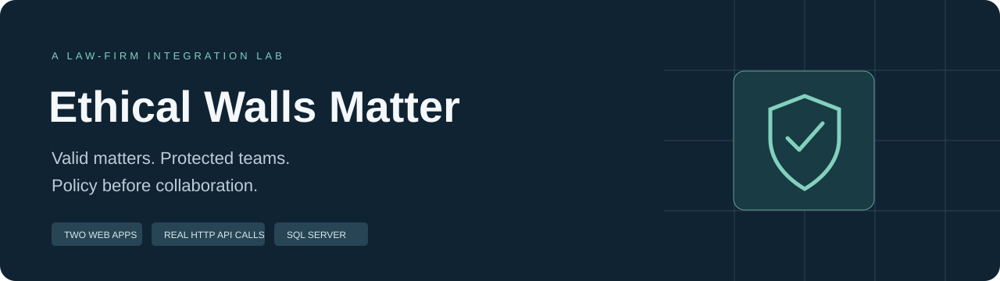
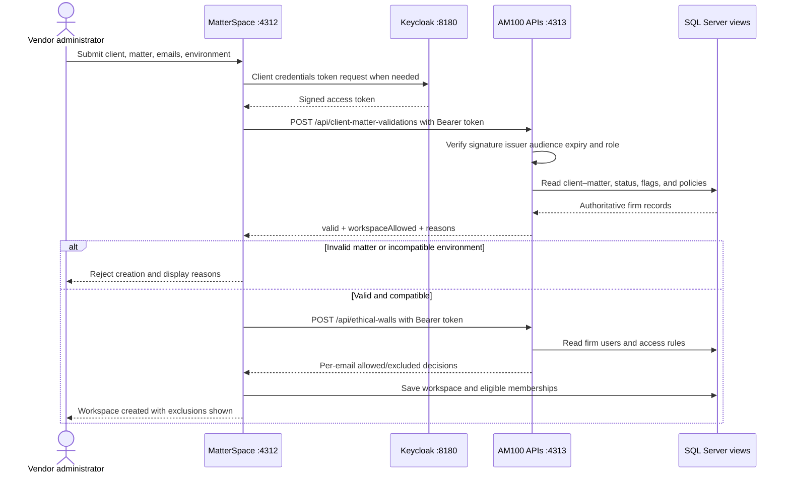

<p align="center"></p>

<h1 align="center">Ethical Walls Matter</h1>
<p align="center"><strong>Valid matters. Protected teams. Policy before collaboration.</strong></p>
<p align="center">Two web applications · SQL Server views · Keycloak OAuth 2.0 · Interactive Swagger</p>
<p align="center"><a href="LICENSE">MIT licensed</a> · <a href="#installation-from-scratch">Install</a> · <a href="#your-first-walkthrough">Try the workflow</a> · <a href="#sql-server-guide">Explore the database</a> · <a href="#swagger-and-api-examples">Explore the APIs</a></p>

**Ethical Walls Matter** is a hands-on law-firm integration lab. A hypothetical vendor wants to create a workspace. A fictional AM100 law firm decides whether the client–matter is valid, whether the workspace's environment is compatible with matter restrictions, and which people can join.

This is a working demonstration with editable data and actual server-to-server HTTP requests. It is not a production document-management or compliance system.

## What you get

**New local OAuth lab:** start with `Start-OAuth.bat` to run Keycloak on [localhost:8180](http://localhost:8180), protected APIs on port **4313**, and both applications. The [Learning Manual](docs/LEARNING-MANUAL.md) provides detailed SSMS, Windows service-account, Keycloak, token, and Swagger exercises. A [Word edition](docs/Ethical-Walls-Matter-Learning-Manual.docx) is included. Docker Desktop must be running with its Linux engine. Initial setup generates credentials only in ignored `.local-data/oauth/` files.

| Application | Purpose | Local URL |
|---|---|---|
| **AM100 Firm Control** | Manage clients, matters, users, ethical walls, flags, API availability, and policy | [localhost:4311](http://localhost:4311) |
| **MatterSpace Vendor** | Create workspaces, inspect admitted/excluded members, and recheck access | [localhost:4312](http://localhost:4312) |
| **Protected integration API** | Validate client–matters and ethical walls using Bearer tokens | `http://localhost:4313` (API/docs routes only) |
| **Keycloak** | Manage the local realm, vendor OAuth client, roles, and signing keys | [Administration console](http://localhost:8180/admin/) |
| **Client–Matter Swagger** | Execute validation, batch validation, and health requests | [Validation documentation](http://localhost:4311/docs/client-matter-validations) |
| **Ethical Walls Swagger** | Execute email-based membership decisions | [Ethical walls documentation](http://localhost:4311/docs/ethical-walls) |
| **SQL Server database** | Inspect the tables and views that supply local API data | `.\SQLEXPRESS` → `AM100IntegrationDemo` |

The project name is **Ethical Walls Matter**. AM100 and MatterSpace remain the names of its two fictional participants. The database and launcher names retain their existing AM100 names for compatibility.

## Contents

- [How the workflow works](#how-the-workflow-works)
- [Prerequisites and supported modes](#prerequisites-and-supported-modes)
- [Installation from scratch](#installation-from-scratch)
- [Start and stop](#start-and-stop)
- [Update an existing installation](#update-an-existing-installation)
- [Your first walkthrough](#your-first-walkthrough)
- [Administering the firm](#administering-the-firm)
- [Matter flags and restrictions](#matter-flags-and-restrictions)
- [SQL Server guide](#sql-server-guide)
- [Swagger and API examples](#swagger-and-api-examples)
- [Configuration](#configuration)
- [Developer guide](#developer-guide)
- [Troubleshooting](#troubleshooting)
- [Security and scope](#security-and-scope)
- [License and attribution](#license-and-attribution)

## How the workflow works



The vendor saves a workspace only after both APIs succeed, both responses use the same policy revision, and at least one eligible member remains. A restricted person is excluded; their presence does not block other eligible people. An unavailable API prevents creation.

Access rules apply to all vendor workspaces for a selected client–matter. Existing workspaces are reconciled with **Recheck access**; this demo does not push policy changes automatically.

## Prerequisites and supported modes

### Recommended: Windows + SQL Server + Keycloak OAuth

| Component | Required? | Purpose |
|---|---|---|
| Windows supported by your SQL Server release | Yes | Local integrated-authentication SQL bridge and launch scripts |
| Node.js **22 or newer** | Yes | Runs both applications, APIs, builds, and tests |
| npm | Included with Node.js | Runs project commands |
| SQL Server Express Database Engine | Yes | Stores the local demo's data |
| Windows PowerShell (`powershell.exe`) | Yes | Connects Node.js to SQL Server with Windows authentication |
| Microsoft `sqlcmd` | Yes for launcher/setup | Applies the SQL schema |
| SQL Server Management Studio (SSMS) | Recommended | Lets you inspect the database, tables, views, and query results |
| Git | Recommended | Clones the repository and manages changes |
| Docker Desktop with Linux engine and Compose | Yes for OAuth lab | Runs the local Keycloak authorization server |
| Keycloak **26.8.1** container | Downloaded by setup | Issues vendor client credentials tokens; no separate Java install needed on Windows |

The SQL integration has been exercised on Windows with SQL Server Express 2025 (`SQLEXPRESS`), SSMS 22, Windows PowerShell, and Node.js 24. The declared minimum Node version is 22. Other SQL Server releases may work, but are not the tested baseline. Use the official product system requirements when selecting a SQL Server version.

**SSMS is a database viewer/administration tool. Installing SSMS alone does not install the SQL Server Database Engine.**

### Other modes

- **JSON fallback:** `npm.cmd run start:json` runs the same applications with local JSON persistence. It does not require SQL Server, SSMS, or the SQL bridge. Node.js is still required.
- **Isolated tests/build:** `npm test` and `npm run build` do not require SQL Server. These are the checks run in GitHub Actions.
- **Optional hosted Worker artifacts:** `npm run build` generates separate Cloudflare/D1 artifacts. This does not publish anything and does not migrate your local SQL data. See [deployment boundaries](docs/COMPATIBILITY.md).

Run `npm ci` after cloning. The local HTTP host uses the pinned `jose` dependency for JWT verification. Swagger UI assets are vendored with their upstream license. Docker Desktop is additionally required for the local Keycloak OAuth lab; `Start-OAuth.bat` installs npm dependencies and prepares that lab.

## Installation from scratch

### 1. Install Node.js

1. Open the [official Node.js download page](https://nodejs.org/en/download).
2. Download a supported **LTS Windows installer**, version 22 or newer, matching your computer.
3. Run the installer and keep Node.js/npm available on `PATH`.
4. Open a **new PowerShell window** after installation.
5. Verify:

```powershell
node --version
npm.cmd --version
```

The Windows examples use `npm.cmd` to avoid PowerShell execution-policy issues with the optional `npm.ps1` shim.

### 2. Install Git and download the project

Install [Git for Windows](https://git-scm.com/downloads/win), then open a new PowerShell window:

```powershell
git --version
git clone https://github.com/RamiJaloudi/ethical-walls-matter.git
cd ethical-walls-matter
npm.cmd ci
```

Alternatively, choose **Code → Download ZIP** on GitHub, extract the archive, and open the extracted project folder. Do not run the batch file from inside the ZIP preview.

### 3. Install SQL Server Express

If you already have a working SQL Server instance, keep it and go to step 4. Otherwise:

1. Open [Microsoft's SQL Server downloads page](https://www.microsoft.com/en-us/sql-server/sql-server-downloads).
2. Choose **SQL Server Express** and use the installer appropriate for your Windows version.
3. Install the **Database Engine**. You do not need Reporting Services, Analysis Services, or Integration Services for this project.
4. Use a named instance called **SQLEXPRESS** for the simplest setup. If the installer creates a different instance, record its name and use the configuration instructions below.
5. Use **Windows authentication**. Add the Windows account that will run this demo as an administrator of this development instance when the installer offers that option.
6. Finish installation and ensure the SQL Server service is running.

For a custom installation, consult [Microsoft's Database Engine installation guide](https://learn.microsoft.com/en-us/sql/database-engine/install-windows/install-sql-server-from-the-installation-wizard-setup).

Check the default instance from PowerShell:

```powershell
Get-Service -Name 'MSSQL$SQLEXPRESS'
```

If it is installed but stopped, start it from **Services**, or from an administrator PowerShell window:

```powershell
Start-Service -Name 'MSSQL$SQLEXPRESS'
```

The launcher can start this default service, but Windows may require elevation for that operation. Running the apps normally does not require an administrator terminal once the service is running and database permissions are in place.

### 4. Install SSMS

1. Follow [Microsoft's SSMS installation guide](https://learn.microsoft.com/en-us/ssms/install/install).
2. Install SSMS 22 for the same baseline as the launcher.
3. Open SSMS and connect with:

| Connection setting | Value |
|---|---|
| Server type | Database Engine |
| Server name | `.\SQLEXPRESS` |
| Authentication | Windows Authentication |

For this local development instance, you may need the connection's **Trust server certificate** option when using SQL Server's locally generated certificate. The launcher uses the corresponding `-C` option for its local `sqlcmd`/SSMS connections. A production connection should use an appropriately configured certificate.

The launcher checks the standard SSMS 22 installation path, then `Ssms.exe` on `PATH`. You can still run the apps without SSMS; the launcher reports that the viewer was not found.

### 5. Install and verify sqlcmd

Follow the [official sqlcmd installation guide](https://learn.microsoft.com/en-us/sql/tools/sqlcmd/sqlcmd-download-install). Microsoft offers **ODBC** and **Go** variants. The exercised Windows setup uses the ODBC-based SQL Server Command Line Utilities and its required Microsoft ODBC driver. If you choose the newer Go variant, verify the classic connection flags below before running the launcher.

Open a new PowerShell window and check:

```powershell
Get-Command sqlcmd.exe
sqlcmd -?
sqlcmd -S '.\SQLEXPRESS' -E -C -b -Q "SELECT @@SERVERNAME AS ServerName;"
```

`-E` uses your Windows identity; no SQL password is needed. If the command is not found, add the installed utilities directory to `PATH`, or reopen the terminal after installation. The ODBC variant is commonly installed under SQL Server's **Client SDK / ODBC / Tools / Binn** directory.

### 6. Install Docker Desktop for Keycloak

1. Follow the [official Docker Desktop Windows installation guide](https://docs.docker.com/desktop/setup/install/windows-install/) for your Windows version and hardware.
2. Use the WSL 2 backend for this lab. If WSL is missing, follow that guide's installation steps and restart Windows when requested. Hardware virtualization must be enabled.
3. Start **Docker Desktop** from the Start menu and complete its first-run prompts. Installing it alone does not start the engine.
4. Confirm Docker is running **Linux containers**, then open a new PowerShell window in the project folder.
5. Verify both Docker Client and Server are available, and Compose is installed:

```powershell
wsl --version
docker version
docker compose version
```

The project's setup downloads `quay.io/keycloak/keycloak:26.8.1` and exposes it only at `http://localhost:8180`; Keycloak's internal container port is 8080. The first download requires network access and can take several minutes. You do not need to install Java or download a separate Keycloak ZIP for this Docker setup. See the [upstream Keycloak Docker guide](https://www.keycloak.org/getting-started/getting-started-docker) for background; use this project's launcher and generated credentials rather than its example password.

### 7. Check prerequisites from the project folder

```powershell
npm.cmd run doctor
```

This reports the installed commands, SQL service/connection, database presence, ports, and standard SSMS path. It does not install software or change your database. A missing database before first startup is expected.

### 8. Launch the complete SQL and OAuth lab

In File Explorer, open the cloned project folder and double-click:

**`Start-OAuth.bat`**

Or run it from PowerShell:

```powershell
.\Start-OAuth.bat
```

The launcher:

1. Runs `npm ci` to install the locked dependencies.
2. Generates random local credentials, a Keycloak realm import, and Docker Compose configuration under ignored `.local-data/oauth/` files.
3. Starts the persistent Keycloak container and waits for the `ethical-walls-matter` realm. The imported vendor client has `ClientMatter.Validate` and `EthicalWalls.Check` roles for audience `am100-api`.
4. Stops a previous launcher-owned app process so it cannot silently reuse an older unsecured instance. Unrelated processes are left running.
5. Checks Node.js and `sqlcmd` and ensures the default SQLEXPRESS service is running.
6. Applies **both** `sql/schema.sql` and `sql/api-views.sql` to **AM100IntegrationDemo**. This installs the seven API views, `api.AppendAudit`, and `Am100ApiReader` as well as the original tables and views.
7. Seeds fictional records on first initialization and preserves initialized SQL records on later starts. Existing local JSON demo files can supply the first import.
8. Starts AM100 on **4311**, MatterSpace on **4312**, and the OAuth-protected API on **4313**, using your current Windows identity for SQL.
9. Waits for the apps, opens the firm/vendor browser pages, and opens SSMS with `sql/Inspect-AM100.sql`.

The script does not install SQL Server, enable network protocols, open firewall ports, or modify unrelated databases. The browser and SSMS are visible; the app server runs in the background and writes local startup logs.

The launcher creates the **vendor's OAuth service account**, not a Windows service account. To create a separate Windows identity for the API and grant SQL view access manually, follow [Learning Manual sections 6–9](docs/LEARNING-MANUAL.md#6-create-the-windows-service-account-yourself). The vendor receives no SQL login. Your initial all-in-one lab uses your existing Windows account.

### 9. Verify the installation

In a second PowerShell window, from the project root:

```powershell
npm.cmd run check:oauth
```

Expected output includes **Without token: HTTP 401**, **With token: HTTP 200**, and **Ethical Walls with token: HTTP 200**. These checks verify authorization and connectivity; inspect response fields or use the walkthrough to test business decisions.

Open [AM100](http://localhost:4311), [MatterSpace](http://localhost:4312), and [Keycloak administration](http://localhost:8180/admin/). The initial Keycloak username is `admin`; open `.local-data/oauth/config.json` privately in an editor for `KEYCLOAK_ADMIN_PASSWORD`. The same file contains the vendor client secret. Never commit or share it. Re-running setup preserves an existing realm; changing an import file does not update that realm. Use the Keycloak console for later changes and keep the vendor's local secret synchronized.

## Start and stop

| Task | Command |
|---|---|
| Recommended full SQL + OAuth startup, browser pages, and SSMS | `.\Start-OAuth.bat` |
| SQL startup only; uses OAuth if already configured, but does not start Keycloak | `.\Start-AM100.bat` |
| Stop launcher-owned apps/APIs | `.\Stop-AM100.bat` |
| SQL servers in the current terminal, after setup | `npm.cmd start` |
| Explicit SQL startup alias | `npm.cmd run start:sql` |
| JSON fallback, with SQL apps stopped | `npm.cmd run start:json` |
| Check prerequisites | `npm.cmd run doctor` |
| Prepare/start Keycloak only; requires Docker engine | `npm.cmd run setup:oauth` |
| Verify the running protected APIs | `npm.cmd run check:oauth` |
| Start a separate API process after configuring its identity | `npm.cmd run start:api` |
| Stop Keycloak and preserve its data | `docker stop ethical-walls-matter-keycloak-1` |

For terminal-launched servers, press **Ctrl+C** in their terminal. The stop batch file stops only the recorded launcher-owned Node process; it does not stop SQL Server or close SSMS.

Both storage modes use ports **4311** and **4312**, so they cannot run on those ports simultaneously. OAuth SQL mode also uses **4313**, with Keycloak on **8180**. Do not run the JSON fallback and the SQL launcher at the same time. Unrelated processes are not silently killed or reused. `Stop-AM100.bat` leaves Keycloak running; stop its container separately if desired. Restart with `Start-OAuth.bat` to bring the full lab back up.

Startup logs and the launcher PID file are under `.local-data/`. This directory is excluded from Git.

## Update an existing installation

Back up your demo database before applying schema updates. In the existing project folder:

```powershell
.\Stop-AM100.bat
git pull --ff-only
npm.cmd ci
.\Start-OAuth.bat
npm.cmd run check:oauth
```

Stop foreground servers with Ctrl+C in their original terminals instead of the stop batch file. If Git reports local changes or divergent history, resolve those changes before continuing; do not discard local work. Start Docker Desktop before the OAuth launcher. The launcher reapplies both SQL scripts and preserves existing business records and Keycloak data. It does not automatically update an already imported realm or rotate secrets.

If a database administrator applies SQL separately, have them execute `sql/schema.sql` **then** `sql/api-views.sql`, followed by the appropriate account mapping. Refresh SSMS Views and Stored Procedures. If you run `scripts/api.mjs` separately under a restricted Windows identity, stop/restart that process under the same identity and follow the [separate API instructions](docs/LEARNING-MANUAL.md#9-run-the-api-under-that-windows-identity) instead of starting a second host on port 4313.

## Your first walkthrough

Start with an unchanged fictional seed dataset. If you have already edited the records, your results follow the current saved policy.

### A. Create a mixed-team workspace

1. Open [MatterSpace](http://localhost:4312).
2. Choose **Create workspace**, then the **Mixed team** scenario.
3. Keep client `1001`, matter `001`, and the default workspace environment.
4. Select **Validate & create workspace**.
5. Alex Morgan and Sam Rivera are admitted. Jordan Lee is excluded by an explicit matter restriction.
6. Inspect the two API request/response traces in the result dialog.
7. Open **API activity** on AM100. Matching request IDs connect the vendor requests to the firm decisions.

### B. Switch the ethical wall policy

1. In AM100, open **Settings**.
2. The default is **1. Deny listed people; allow other active firm users**.
3. Select **2. Allow only explicitly approved people** and save.
4. Create another mixed-team workspace: only Alex has an explicit approval in the seed data.
5. Open the earlier workspace and choose **Recheck access** to apply the current policy to its original proposed team.
6. Restore policy 1 when you finish if you want the default walkthrough behavior again.

Explicit Deny wins in both modes. Unknown/inactive firm users and inactive vendor users are excluded. No eligible members means no workspace is created.

### C. Test invalid matters and outages

- **Invalid matter:** a missing or mismatched matter prevents creation.
- **Closed matter:** an inactive matter prevents creation.
- **Only restricted people:** no eligible team remains, so creation is rejected.
- In firm Settings, disable either API's availability simulator. The vendor prevents creation while that API is unavailable.
- Rechecking an existing workspace when validation cannot succeed suspends it and clears admitted access.

## Administering the firm

### Clients and matters

Open **Clients & matters** to create, edit, or delete records. A valid pair requires an active client, an active matter, and the correct relationship between them.

- Editing a client ID updates its firm-side matters and access rules.
- Editing a matter's ID or client ownership updates related firm access rules.
- Deleting a client or matter removes its associated firm rules after an in-app confirmation.
- Existing vendor workspaces keep their original submitted identifiers; recheck them after changes. Invalid identifiers suspend access rather than silently transferring it to another matter.

### Users and ethical walls

Open **Ethical walls** to manage both users and workspace access rules in one place:

1. Choose **Create user** and supply name, unique employee number, email, role, and active status.
2. Use that user's **Grant / deny access** control.
3. Select the client–matter, decision, and reason; save the rule.
4. Use **Edit access** to change the person, client–matter, decision, or reason.
5. Use **Edit user** or the firm directory to maintain employee details.

Employee numbers are unique **firm-side** records. The vendor matches people by **normalized email address**, never by employee number. Normalize means trimming whitespace and lowercasing. Create corresponding vendor people in MatterSpace's **People** page when needed; a new firm user is not automatically a vendor account.

Email edits update firm rules. They do not silently transfer existing vendor memberships to a new email. Recheck affected workspaces. Removing a firm user also removes their rules; subsequent checks treat the email as unknown.

## Matter flags and restrictions

In **Clients & matters → Edit matter**, choose standard flags or enter custom comma-separated codes. No flags are automatically attached to the existing matters.

Configure each flag in **Settings → Matter flag policies**:

| Flag | Default behavior |
|---|---|
| `NO_CLOUD` / No_Cloud | Block cloud hosting |
| `AI_RESTRICTED` | Block AI-enabled workspaces |
| `NO_EXTERNAL_SHARING` | Block external sharing |
| `EU_DATA_RESIDENCY` | Require EU hosting |
| `US_DATA_RESIDENCY` | Require US hosting |
| `ITAR`, `GDPR`, `APAC` | Informational until the firm configures restrictions |
| `CONFIDENTIAL`, `LEGAL_HOLD`, `EXPORT_CONTROLLED` | Informational until configured |
| Custom codes | Informational until configured |

Admins can block cloud, AI features, external sharing, and/or restrict hosting regions for any flag. All attached restrictions must be satisfied; conflicting US-only and EU-only policies block creation. A global enforcement toggle can make flags informational without removing them.

**Try it:** attach No_Cloud to `1001 / 001`; a cloud workspace is rejected, while an otherwise eligible on-premises workspace can be created. Attach AI_RESTRICTED and enable AI in the vendor form to see the AI restriction.

The vendor environment fields represent simulated deployment capabilities. They do not prove physical residency, export eligibility, or regulatory compliance. Production consumers must source those values from trusted vendor configuration. Legal-hold tagging does not implement document retention in this demo.

## SQL Server guide

### Database, authentication, and permissions

- Default instance: `.\SQLEXPRESS`.
- Dedicated database: **AM100IntegrationDemo**; its name is fixed in this version.
- Authentication: the Windows identity running the application.
- No SQL username/password is stored by the project.

Initial setup needs permission to create the database and its tables/views. The convenience development setup uses the SQL administrator configured during SQL Server installation. If a database administrator provisions it instead, they should apply `sql/schema.sql` followed by `sql/api-views.sql`. The admin/vendor processes need their existing data-store read/write permissions. A separately hosted integration API needs only membership in `Am100ApiReader`, which grants reads on the API views and execution of the audit procedure. Do not run the administrative app under that restricted API role. See [the manual account template](sql/api-service-account.example.sql) and [SSMS mapping steps](docs/LEARNING-MANUAL.md#7-map-the-account-to-sql-using-ssms).

### Schema and data-source map

| Data | Tables | Application/API read views |
|---|---|---|
| Firm users and employee numbers | `FirmUsers` | `vwUsers` |
| Clients | `Clients` | `vwClients` |
| Matters | `Matters` | `vwMatters` |
| Client–matter ownership | `ClientMatters` | `vwClientMatters` |
| Ethical walls | `EthicalWallRules` | `vwEthicalWalls` |
| Policy and API availability | `FirmSettings` | `vwSettings` |
| Flag definitions and restrictions | `FlagPolicies` | `vwFlagPolicies` |
| Matter flag assignments | `MatterFlags` | `vwMatterFlags` |
| Vendor users | `VendorUsers` | `vwVendorUsers` |
| Workspaces | `Workspaces` | `vwWorkspaces` |
| Requested, admitted, and excluded memberships | `WorkspaceMembers` | `vwWorkspaceMembers` |
| API activity | `AuditLog` | `vwAuditLog` |
| Optimistic concurrency | `StateVersions` | Internal transaction control |

There are **13 tables**, **12 administrative/vendor views**, and **7 additional API views** installed by `sql/api-views.sql`. The dedicated OAuth API reads the `api` schema views, which omit employee numbers from `api.Users`, and appends activity through `api.AppendAudit`. The original administrative/vendor SQL adapter continues using the `dbo.vw*` views. The `Am100ApiReader` role grants SELECT only on the seven API views and EXECUTE on the audit procedure. See the [manual](docs/LEARNING-MANUAL.md) for SSMS permissions and a separate Windows API identity.

### Inspect the database in SSMS

1. Connect to `.\SQLEXPRESS` using Windows Authentication.
2. In Object Explorer expand **Databases → AM100IntegrationDemo**.
3. Expand **Tables** and **Views**. Refresh Object Explorer if you applied a schema update while SSMS was open.
4. Open `sql/Inspect-AM100.sql` and press **F5** to execute its read-only inspection queries.
5. Use the results tabs to inspect users, matters, rules, flags, workspaces, and API activity.

Useful read-only queries:

```sql
USE AM100IntegrationDemo;
SELECT * FROM dbo.vwClientMatters;
SELECT * FROM dbo.vwUsers;
SELECT * FROM dbo.vwEthicalWalls;
SELECT * FROM dbo.vwFlagPolicies;
SELECT * FROM dbo.vwMatterFlags;
SELECT * FROM dbo.vwWorkspaces;
SELECT TOP (50) * FROM dbo.vwAuditLog ORDER BY [at] DESC;
SELECT * FROM api.ClientMatters;
SELECT * FROM api.Users; -- Email/active status only; no employee numbers.
SELECT * FROM api.EthicalWalls;
```

Direct SQL changes are reflected on subsequent API reads. Prefer the app controls for ordinary edits because they update related firm references. The demonstration adapter saves normalized snapshots in transactions; avoid making simultaneous manual SQL edits during an application write.

### Manual setup without the launcher

From the project root, with Docker Desktop's Linux engine running:

```powershell
$env:AM100_SQL_SERVER = '.\SQLEXPRESS'
npm.cmd ci
sqlcmd -S $env:AM100_SQL_SERVER -E -C -b -i .\sql\schema.sql
sqlcmd -S $env:AM100_SQL_SERVER -E -C -b -i .\sql\api-views.sql
npm.cmd run setup:sql
npm.cmd run setup:oauth
Invoke-RestMethod 'http://localhost:8180/realms/ethical-walls-matter/.well-known/openid-configuration'
npm.cmd start
```

Run each command only after the previous one succeeds. Keycloak startup is asynchronous: if the discovery request fails while it starts, wait and repeat that request until it returns the realm metadata, then run `npm start`. Leave the server terminal open and run `npm.cmd run check:oauth` in a second window. `setup:sql` seeds/imports records; it does not create either SQL script's objects. Re-running setup preserves initialized SQL data. This manual path does not automatically open browsers or SSMS.

To check the restricted SQL role, run `sql/test-api-permissions.sql` in SSMS as a database administrator. Its test user, audit event, and transaction are rolled back. Creating a real Windows login/database user remains a separate manual exercise; the supplied [service-account SQL](sql/api-service-account.example.sql) contains placeholders to replace, not an automatically executable migration.

### Back up and preserve data

The database lives in SQL Server, not in the Git repository. Copying or cloning this folder does not copy your SQL records.

In SSMS, right-click **AM100IntegrationDemo → Tasks → Back Up**, choose a full database backup, and use a destination the SQL Server service account can write. Store the backup outside the repository. Confirm it completed before experimenting with schema or bulk data changes. Restore through SSMS when required; do not copy live `.mdf`/`.ldf` files while the service is using them.

There is no automatic destructive reset command. Stop the apps and back up first before intentionally rebuilding your demo database. Re-running the launcher is not a reset. An existing `.local-data/firm.json` or `vendor.json` can supply first-import data; it is not continuously synchronized with SQL.

## Swagger and API examples

With the OAuth lab enabled, obtain a Keycloak token using the [manual token exercise](docs/LEARNING-MANUAL.md#11-request-a-token-manually) and use Swagger's **Authorize** button. The examples below describe business payloads; HTTP calls also need `Authorization: Bearer <access-token>` in OAuth mode. `npm run check:oauth` verifies the live protected APIs on port 4313 without printing credentials.

Both Swagger links are in the AM100 **left sidebar** and at the top of **Overview**. They open in new tabs. Use **Try it out → Execute** to call the current firm origin. Requests appear in API activity.

OpenAPI JSON:

- [Client–matter specification](http://localhost:4311/docs/client-matter-validations/openapi.json)
- [Ethical walls specification](http://localhost:4311/docs/ethical-walls/openapi.json)

### Validate a matter and workspace environment

First obtain a token in PowerShell. These commands read the generated local credentials into memory without displaying them:

```powershell
$oauth = Get-Content .\.local-data\oauth\config.json -Raw | ConvertFrom-Json
$token = Invoke-RestMethod -Method Post `
  -Uri ($oauth.AM100_OAUTH_ISSUER + '/protocol/openid-connect/token') `
  -ContentType 'application/x-www-form-urlencoded' `
  -Body @{
    grant_type = 'client_credentials'
    client_id = $oauth.AM100_OAUTH_CLIENT_ID
    client_secret = $oauth.AM100_OAUTH_CLIENT_SECRET
  }
$apiHeaders = @{ Authorization = 'Bearer ' + $token.access_token }
```

Use the following examples in that same PowerShell window. Request a new token after it expires; the vendor backend handles its own token acquisition and caching automatically.

```powershell
$body = @{
  clientId = '1001'
  matterId = '001'
  environment = @{
    hosting = 'cloud'
    region = 'US'
    aiEnabled = $false
    externalSharing = $false
  }
} | ConvertTo-Json -Depth 5

Invoke-RestMethod -Method Post `
  -Uri 'http://localhost:4313/api/client-matter-validations' `
  -Headers $apiHeaders -ContentType 'application/json' -Body $body
```

An HTTP 200 response means the validation ran. Inspect **`valid`** and **`workspaceAllowed`** separately: a real active matter may still prohibit the requested environment. A request without `environment` is a metadata-only check: `environmentChecked` is false and it does not grant workspace approval.

The response also includes names, combined `clientMatterId`, `matterStatus`, `aiRestrictionsFlag`, flags, configured policies, violation reasons, and `policyRevision`.

### Check people by email

```powershell
$body = @{
  clientId = '1001'
  matterId = '001'
  emails = @('alex.morgan@am100.example', 'jordan.lee@am100.example')
} | ConvertTo-Json

Invoke-RestMethod -Method Post `
  -Uri 'http://localhost:4313/api/ethical-walls' `
  -Headers $apiHeaders -ContentType 'application/json' -Body $body
```

### Endpoint reference

Hosts and role requirements below describe the recommended SQL + OAuth mode. The admin/vendor UI routes remain loopback-only demonstration interfaces without user sign-in.

| Method and endpoint | Host and access | Purpose |
|---|---|---|
| `GET /api/state` | 4311 firm or 4312 vendor; local demo UI | Current app records; absent from dedicated API host |
| `POST /api/client-matter-validations` | 4313 API or 4311 proxy; `ClientMatter.Validate` role | Validate one pair and optional environment |
| `POST /api/client-matter-validations/batch` | 4313 API or 4311 proxy; `ClientMatter.Validate` role | Validate 1–100 requests; preserve input order |
| `POST /api/ethical-walls` | 4313 API or 4311 proxy; `EthicalWalls.Check` role | Evaluate up to 100 email addresses |
| `GET /api/health` | 4313 API or 4311 proxy; no token | Observe firm database/API availability |
| `POST /api/admin` | 4311 only; local demo admin UI | Firm administrative mutations |
| `POST /api/people` | 4312 only; local demo vendor UI | Vendor-directory mutations |
| `POST /api/workspaces` | 4312 only; local demo vendor UI | Vendor validation and creation workflow |
| `POST /api/workspaces/:id/recheck` | 4312 only; local demo vendor UI | Reconcile saved members/environment with current firm policy |

Common outcomes: **200** successful check; **201** created workspace; **400** malformed input; **401** missing, expired, or invalid token; **403** insufficient API role or rejected cross-origin browser write; **409** concurrency/policy revision conflict; **413** request too large; **415** unsupported content type; **422** blocked vendor creation/recheck; **503** unavailable dependency. Business-route errors include `error` and a structured `errorResponse` envelope; the OAuth gate returns an `error` string and `WWW-Authenticate` header. Exact operations and schemas are in Swagger.

## Configuration

`.env.example` lists supported environment variables. **The scripts do not automatically load `.env` files.** SQL startup automatically loads `.local-data/oauth/config.json` when it exists; environment variables set in PowerShell take precedence. The separate API entry point skips that file when `AM100_OAUTH_ENABLED` is already set, allowing its restricted service identity to use public configuration without reading vendor secrets. See [the service runner example](scripts/run-api-service.example.ps1).

| Variable | Used by | Default / behavior |
|---|---|---|
| `AM100_SQL_SERVER` | SQL bridge, setup, launcher | `.\SQLEXPRESS` |
| `FIRM_URL` | JSON development vendor / hosted vendor runtime | Local JSON runner defaults to its local firm URL; SQL OAuth runner uses fixed localhost:4313 |
| `FIRM_SERVICE_TOKEN` | Vendor-to-firm hosted HTTP calls | Optional platform access token; separate from OAuth and not required by the local Keycloak lab |
| `AM100_OAUTH_ENABLED` | Local SQL/API startup | `true` in generated config; absent means legacy SQL demo without OAuth |
| `AM100_OAUTH_ISSUER` | API verifier and vendor token client | `http://localhost:8180/realms/ethical-walls-matter` in generated config |
| `AM100_OAUTH_AUDIENCE` | API verifier | `am100-api` |
| `AM100_OAUTH_CLIENT_ID` | Vendor backend | `matterspace-vendor` |
| `AM100_OAUTH_CLIENT_SECRET` | Vendor backend | Generated locally; never embed in browser code or commit |
| `AM100_EXTERNAL_API` | SQL app runner | `true` uses a separately running API on 4313 instead of starting one in the app process |
| `AM100_API_PORT` | Standalone `scripts/api.mjs` only | 4313; app runner/proxy/vendor routing is fixed to 4313, so changing it also requires routing changes |
| `KEYCLOAK_ADMIN_PASSWORD` | Keycloak setup | Generated initial admin credential in ignored config; not needed to validate API tokens |
| `AM100_FIRM_SITE_URL` | Worker build peer links | Local firm URL unless local hosting configuration supplies one |
| `AM100_VENDOR_SITE_URL` | Worker build peer links | Local vendor URL unless local hosting configuration supplies one |

To use an existing SQL instance:

```powershell
$env:AM100_SQL_SERVER = 'MY-PC\MYINSTANCE'
.\Start-OAuth.bat
```

Only the default SQLEXPRESS service is automatically started. Manage other instances yourself. The database name remains `AM100IntegrationDemo`. The SQL bridge uses Windows authentication; SQL-password authentication is not implemented.

For generated hosted peer links, set both `AM100_*_SITE_URL` variables before building. An ignored `.local-data/hosting-origins.json` can also contain `firm` and `vendor` URL values; environment variables take precedence. Do not put credentials in this file.

## Developer guide

### Repository layout

```text
src/
  ui.mjs                 Both UIs, styles, forms, and browser behavior
  core.mjs               API routes and business rules
  flags.mjs              Flag definitions and environment restrictions
  swagger.mjs            OpenAPI generation and Swagger pages
  sql-store.mjs          SQL-backed data adapter
  api-sql-store.mjs      API views and narrowly scoped audit writes
  oauth.mjs              JWT verification and vendor token acquisition/cache
  vendor/                Vendored Swagger UI and upstream notices
scripts/
  server.mjs             Local HTTP adapter and JSON/in-memory persistence
  dev-sql.mjs            SQL-backed application pair
  dev.mjs                JSON fallback application pair
  sql-bridge.ps1         Windows-authenticated, parameterized SQL execution
  setup-sql.mjs          Initial seed/import, preserving existing SQL records
  setup-oauth.mjs        Keycloak realm, credentials, and persistent container setup
  oauth-config.mjs       Ignored local OAuth configuration loader
  api.mjs                Standalone OAuth-protected API host
  run-api-service.example.ps1  Public configuration for a separate Windows identity
  check-oauth.mjs        Live Keycloak/API verification
  launch-oauth.ps1       Complete OAuth + SQL startup
  launch-sql.ps1         Full Windows launcher
  stop-sql.ps1           Stops only its recorded app process
  doctor.ps1             Read-only prerequisite diagnostics
  build.mjs              Generates optional Worker artifacts
sql/
  schema.sql             Additive schema and read views
  api-views.sql          API views, audit procedure, and restricted role
  api-service-account.example.sql  Manual Windows login/database user template
  test-api-permissions.sql  Rolled-back SQL role verification
  Inspect-AM100.sql      Read-only SSMS inspection queries
tests/
  integration.test.mjs   Isolated real-HTTP application checks
  oauth.test.mjs         Token verification, endpoint roles, and vendor OAuth checks
  sql.integration.test.mjs  Actual SQL-backed end-to-end check
docs/                    Learning Manual (Markdown and Word), branding, compatibility
.github/workflows/ci.yml  Isolated tests + fresh build; no deployment
Start-OAuth.bat / Start-AM100.bat / Stop-AM100.bat
```

`.mjs` files are plain JavaScript ES modules. Edit `src/`; `apps/firm/worker/index.js` and `apps/vendor/worker/index.js` are generated deployment entry points. A generated Worker combines UI, API handlers, and D1 persistence into one deployable module.

### Tests

```powershell
npm.cmd test
npm.cmd run test:sql
npm.cmd run check:oauth
```

The regular suite currently has **21 tests**: 15 application tests and 6 OAuth tests. It starts isolated HTTP servers on temporary ports, serves test signing keys, and does not require SQL Server, Docker, or Keycloak or alter saved demo records. Run `npm ci` first on a fresh clone.

`check:oauth` is a separate live check: it requires the configured Keycloak realm and SQL-backed API host already running. It verifies both endpoints with real tokens and rejects requests without tokens. For SQL role permissions, execute `sql/test-api-permissions.sql` as an administrator; it rolls back its test changes.

The SQL test requires the provisioned database and uses uniquely named fictional fixtures. It checks SQL-view reads, environment/flag persistence, API decisions, workspace creation, and the effect of a direct SQL change. Fixture entities are removed afterward; their audit events remain. Allow extra time for the Windows PowerShell/SQL bridge. Use only the dedicated demo database.

### Build from a clean clone

```powershell
npm.cmd run build
```

This creates `apps/firm` and `apps/vendor`, including Worker source, output, a hosting manifest, and a D1 migration. Those folders are generated and ignored by Git. Build succeeds without an existing Sites account or deployment folder. It does **not** start servers, apply the Microsoft SQL schema, or publish a site.

Hosting requires a compatible deployment environment and its own credentials, D1 bindings/migrations, and private access configuration. Existing private site IDs are not distributed in the source repository. See [compatibility and deployment boundaries](docs/COMPATIBILITY.md).

### GitHub workflow

GitHub Actions runs `npm ci`, the isolated application/OAuth HTTP suite, a fresh artifact build, and syntax checks using Node.js 22. SQL integration and live Keycloak checks stay local Windows checks; CI does not install SQL Server, run the Keycloak container, publish websites, or change your database.

See [CONTRIBUTING.md](CONTRIBUTING.md) for source locations and change expectations. Local SQL data, deployment repositories/identities, credentials, logs, screenshots, private reference documents, and review outputs are intentionally excluded from the public source repository.

## Troubleshooting

| Symptom | What to check |
|---|---|
| `node` / `npm` not found | Install Node.js, reopen the terminal, verify `PATH`. Use `npm.cmd` in PowerShell. |
| PowerShell blocks `npm.ps1` | Use `npm.cmd`; no machine-wide policy change is needed. |
| `sqlcmd` not found | Install the utilities/required driver and reopen the terminal. Run `Get-Command sqlcmd.exe`. |
| SSMS installed but no SQL service | Install the Database Engine. SSMS alone is not a server. |
| SQLEXPRESS service stopped | Start it in Services or an administrator terminal; then rerun the launcher. |
| Login failed for Windows user | Use the same Windows account granted SQL access. Verify with the `sqlcmd -E` connection check. |
| Cannot create database / permission denied | Have the local SQL administrator provision `sql/schema.sql` or grant appropriate development permissions. |
| Certificate error on the local instance | Review the local certificate trust option described in installation; use properly configured certificates for shared/production environments. |
| Port 4311, 4312, or 4313 already in use | Stop the previous demo instance in its original terminal or use Stop-AM100.bat for launcher-owned apps. A separate API on 4313 requires AM100_EXTERNAL_API=true and the manual service-identity workflow. Do not kill an unrelated process. |
| Docker reports no engine or pipe not found | Start Docker Desktop and wait for the Linux engine. `docker version` must report Server as well as Client. |
| Keycloak cannot bind port 8180 | Check the current listener and Windows excluded port ranges; preserve unrelated services. Keep Docker port mapping, issuer, and application configuration consistent if changing ports. |
| Keycloak realm unavailable during first startup | Allow time for image download and realm import. Inspect the lab container logs in Docker Desktop. |
| OAuth token request returns invalid_client | Check the vendor client ID/secret, Client authentication, and Service accounts roles in Keycloak. Regenerated secrets must be copied to the ignored config and the vendor restarted. |
| API returns 401 | Request a fresh token; check the exact issuer, audience, signature, and expiry. Use Swagger Authorize or the README Bearer-header example. |
| API returns 403 with a valid token | Assign the endpoint role to the service account and its client role scope mappings. The two APIs require different roles. |
| Start-AM100 starts apps but OAuth calls fail | It does not start Keycloak; use Start-OAuth.bat for complete startup. A saved OAuth config enables protected mode on subsequent SQL starts. |
| Browser shows an old UI after an update | Restart the local Node app to reload the source, then refresh the browser. |
| Data did not reset after startup | Expected: startup preserves SQL records. Use your current saved records or intentionally restore/recreate a backed-up demo database. |
| A new firm user cannot join | Add their matching email to the vendor directory; verify both accounts are active and the firm policy allows access. |
| Flags seem ineffective | Check that the matter has the flag, enforcement is enabled, and its policy has explicit restrictions. ITAR/GDPR/APAC start informational. |
| Existing workspace still shows old members | Use Recheck access; policy changes are not automatically pushed. |
| No eligible members / suspended workspace | Inspect the API traces and firm activity log for matter, flag, identity, outage, or policy reasons. |
| SSMS does not open automatically | Use SSMS 22's standard installation path or put Ssms.exe on PATH; open the inspection query manually. |
| SQL tables/views missing after a pull | Stop apps, apply sql/schema.sql then sql/api-views.sql successfully, seed only if needed, and restart. Start-OAuth.bat applies both scripts automatically. Refresh SSMS Object Explorer. |
| Restricted API SQL identity gets permission denied | Apply api-views.sql and grant its database user Am100ApiReader. Do not add broad write/admin roles to the API account. |
| Edits to realm.json do not change Keycloak | Startup import preserves an existing realm. Apply later changes in the Keycloak console and keep local vendor credentials synchronized. |
| Launcher appears to do nothing | Read .local-data/sql-apps.log and sql-apps-error.log; run it from PowerShell to keep messages visible. |
| JSON and SQL records differ | They are separate stores. JSON is an explicit fallback and first-import source, not a live SQL mirror. |
| Hosted demo and local records differ | Hosted D1 and local SQL are separate environments. A cloud URL cannot reach SQL Server on your PC automatically. |

Start diagnostics with `npm.cmd run doctor`. For startup errors, inspect `.local-data/sql-apps-error.log`. Do not paste credentials or real client/matter records into public issues.

## Security and scope

The local apps bind to loopback. When configured by `Start-OAuth.bat`, Keycloak client credentials tokens protect validation, batch validation, and ethical-wall endpoints on the dedicated API host and the firm proxy. The admin and vendor UIs still have no end-user sign-in. Use fictional data; this is a demonstration, not a shared production deployment. Legacy JSON mode and SQL mode without OAuth configuration remain explicit unsecured loopback demos.

The code enforces policy at workspace creation/recheck. It does not implement document storage/access, automatic access revocation, immutable audit retention, or tenant isolation. OAuth authenticates the vendor application; it does not sign in administrators or employees. The administrative SQL adapter uses parameterized commands and transaction/version checks but saves app snapshots rather than targeted production row updates. The API store reads dedicated views and calls an append procedure instead of rewriting business data.

For shared deployment, see the explicit [production boundaries](docs/COMPATIBILITY.md). GitHub publication publishes source only; it does not expose your database, start a public API, or deploy the web apps.

## License and attribution

Original project code is licensed under the [MIT License](LICENSE). Swagger UI Distribution 5.17.14 retains its Apache 2.0 license and notice. See [THIRD_PARTY_NOTICES.md](THIRD_PARTY_NOTICES.md).

Official installation references: [Node.js](https://nodejs.org/en/download), [Git for Windows](https://git-scm.com/downloads/win), [SQL Server downloads](https://www.microsoft.com/en-us/sql-server/sql-server-downloads), [Database Engine setup](https://learn.microsoft.com/en-us/sql/database-engine/install-windows/install-sql-server-from-the-installation-wizard-setup), [SSMS](https://learn.microsoft.com/en-us/ssms/install/install), [sqlcmd](https://learn.microsoft.com/en-us/sql/tools/sqlcmd/sqlcmd-download-install), [Docker Desktop for Windows](https://docs.docker.com/desktop/setup/install/windows-install/), and [Keycloak on Docker](https://www.keycloak.org/getting-started/getting-started-docker).
