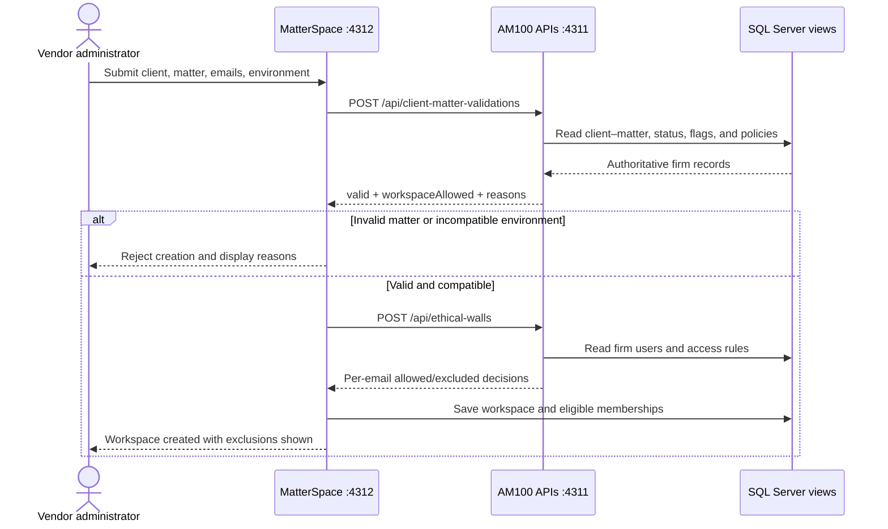

<p align="center"></p>

<h1 align="center">Ethical Walls Matter</h1>
<p align="center"><strong>Valid matters. Protected teams. Policy before collaboration.</strong></p>
<p align="center">Two web applications · Real HTTP integration · SQL Server views · Interactive Swagger</p>
<p align="center"><a href="LICENSE">MIT licensed</a> · <a href="#installation-from-scratch">Install</a> · <a href="#your-first-walkthrough">Try the workflow</a> · <a href="#sql-server-guide">Explore the database</a> · <a href="#swagger-and-api-examples">Explore the APIs</a></p>

**Ethical Walls Matter** is a hands-on law-firm integration lab. A hypothetical vendor wants to create a workspace. A fictional AM100 law firm decides whether the client–matter is valid, whether the workspace's environment is compatible with matter restrictions, and which people can join.

This is a working demonstration with editable data and actual server-to-server HTTP requests. It is not a production document-management or compliance system.

## What you get

| Application | Purpose | Local URL |
|---|---|---|
| **AM100 Firm Control** | Manage clients, matters, users, ethical walls, flags, API availability, and policy | [localhost:4311](http://localhost:4311) |
| **MatterSpace Vendor** | Create workspaces, inspect admitted/excluded members, and recheck access | [localhost:4312](http://localhost:4312) |
| **Client–Matter Swagger** | Execute validation, batch validation, and health requests | [Validation documentation](http://localhost:4311/docs/client-matter-validations) |
| **Ethical Walls Swagger** | Execute email-based membership decisions | [Ethical walls documentation](http://localhost:4311/docs/ethical-walls) |
| **SQL Server database** | Inspect the tables and views that supply local API data | `.\SQLEXPRESS` → `AM100IntegrationDemo` |

The project name is **Ethical Walls Matter**. AM100 and MatterSpace remain the names of its two fictional participants. The database and launcher names retain their existing AM100 names for compatibility.

## Contents

- [How the workflow works](#how-the-workflow-works)
- [Prerequisites and supported modes](#prerequisites-and-supported-modes)
- [Installation from scratch](#installation-from-scratch)
- [Start and stop](#start-and-stop)
- [Your first walkthrough](#your-first-walkthrough)
- [Administering the firm](#administering-the-firm)
- [Matter flags and restrictions](#matter-flags-and-restrictions)
- [SQL Server guide](#sql-server-guide)
- [Swagger and API examples](#swagger-and-api-examples)
- [Configuration](#configuration)
- [Developer guide](#developer-guide)
- [Troubleshooting](#troubleshooting)
- [Security and scope](#security-and-scope)
- [License and attribution](#license-and-attribution)

## How the workflow works



The vendor saves a workspace only after both APIs succeed, both responses use the same policy revision, and at least one eligible member remains. A restricted person is excluded; their presence does not block other eligible people. An unavailable API prevents creation.

Access rules apply to all vendor workspaces for a selected client–matter. Existing workspaces are reconciled with **Recheck access**; this demo does not push policy changes automatically.

## Prerequisites and supported modes

### Recommended: Windows + SQL Server

| Component | Required? | Purpose |
|---|---|---|
| Windows supported by your SQL Server release | Yes | Local integrated-authentication SQL bridge and launch scripts |
| Node.js **22 or newer** | Yes | Runs both applications, APIs, builds, and tests |
| npm | Included with Node.js | Runs project commands |
| SQL Server Express Database Engine | Yes | Stores the local demo's data |
| Windows PowerShell (`powershell.exe`) | Yes | Connects Node.js to SQL Server with Windows authentication |
| Microsoft `sqlcmd` | Yes for launcher/setup | Applies the SQL schema |
| SQL Server Management Studio (SSMS) | Recommended | Lets you inspect the database, tables, views, and query results |
| Git | Recommended | Clones the repository and manages changes |

The SQL integration has been exercised on Windows with SQL Server Express 2025 (`SQLEXPRESS`), SSMS 22, Windows PowerShell, and Node.js 24. The declared minimum Node version is 22. Other SQL Server releases may work, but are not the tested baseline. Use the official product system requirements when selecting a SQL Server version.

**SSMS is a database viewer/administration tool. Installing SSMS alone does not install the SQL Server Database Engine.**

### Other modes

- **JSON fallback:** `npm.cmd run start:json` runs the same applications with local JSON persistence. It does not require SQL Server, SSMS, or the SQL bridge. Node.js is still required.
- **Isolated tests/build:** `npm test` and `npm run build` do not require SQL Server. These are the checks run in GitHub Actions.
- **Optional hosted Worker artifacts:** `npm run build` generates separate Cloudflare/D1 artifacts. This does not publish anything and does not migrate your local SQL data. See [deployment boundaries](docs/COMPATIBILITY.md).

There are no npm runtime dependencies to install. Swagger UI assets are vendored with their upstream license. `npm install` is not a setup requirement, and `npm ci` is not used by this repository.

## Installation from scratch

### 1. Install Node.js

1. Open the [official Node.js download page](https://nodejs.org/en/download).
2. Download a supported **LTS Windows installer**, version 22 or newer, matching your computer.
3. Run the installer and keep Node.js/npm available on `PATH`.
4. Open a **new PowerShell window** after installation.
5. Verify:

```powershell
node --version
npm.cmd --version
```

The Windows examples use `npm.cmd` to avoid PowerShell execution-policy issues with the optional `npm.ps1` shim.

### 2. Install Git and download the project

Install [Git for Windows](https://git-scm.com/downloads/win), then open a new PowerShell window:

```powershell
git --version
git clone https://github.com/RamiJaloudi/ethical-walls-matter.git
cd ethical-walls-matter
```

Alternatively, choose **Code → Download ZIP** on GitHub, extract the archive, and open the extracted project folder. Do not run the batch file from inside the ZIP preview.

### 3. Install SQL Server Express

If you already have a working SQL Server instance, keep it and go to step 4. Otherwise:

1. Open [Microsoft's SQL Server downloads page](https://www.microsoft.com/en-us/sql-server/sql-server-downloads).
2. Choose **SQL Server Express** and use the installer appropriate for your Windows version.
3. Install the **Database Engine**. You do not need Reporting Services, Analysis Services, or Integration Services for this project.
4. Use a named instance called **SQLEXPRESS** for the simplest setup. If the installer creates a different instance, record its name and use the configuration instructions below.
5. Use **Windows authentication**. Add the Windows account that will run this demo as an administrator of this development instance when the installer offers that option.
6. Finish installation and ensure the SQL Server service is running.

For a custom installation, consult [Microsoft's Database Engine installation guide](https://learn.microsoft.com/en-us/sql/database-engine/install-windows/install-sql-server-from-the-installation-wizard-setup).

Check the default instance from PowerShell:

```powershell
Get-Service -Name 'MSSQL$SQLEXPRESS'
```

If it is installed but stopped, start it from **Services**, or from an administrator PowerShell window:

```powershell
Start-Service -Name 'MSSQL$SQLEXPRESS'
```

The launcher can start this default service, but Windows may require elevation for that operation. Running the apps normally does not require an administrator terminal once the service is running and database permissions are in place.

### 4. Install SSMS

1. Follow [Microsoft's SSMS installation guide](https://learn.microsoft.com/en-us/ssms/install/install).
2. Install SSMS 22 for the same baseline as the launcher.
3. Open SSMS and connect with:

| Connection setting | Value |
|---|---|
| Server type | Database Engine |
| Server name | `.\SQLEXPRESS` |
| Authentication | Windows Authentication |

For this local development instance, you may need the connection's **Trust server certificate** option when using SQL Server's locally generated certificate. The launcher uses the corresponding `-C` option for its local `sqlcmd`/SSMS connections. A production connection should use an appropriately configured certificate.

The launcher checks the standard SSMS 22 installation path, then `Ssms.exe` on `PATH`. You can still run the apps without SSMS; the launcher reports that the viewer was not found.

### 5. Install and verify sqlcmd

Follow the [official sqlcmd installation guide](https://learn.microsoft.com/en-us/sql/tools/sqlcmd/sqlcmd-download-install). Microsoft offers **ODBC** and **Go** variants. The exercised Windows setup uses the ODBC-based SQL Server Command Line Utilities and its required Microsoft ODBC driver. If you choose the newer Go variant, verify the classic connection flags below before running the launcher.

Open a new PowerShell window and check:

```powershell
Get-Command sqlcmd.exe
sqlcmd -?
sqlcmd -S '.\SQLEXPRESS' -E -C -b -Q "SELECT @@SERVERNAME AS ServerName;"
```

`-E` uses your Windows identity; no SQL password is needed. If the command is not found, add the installed utilities directory to `PATH`, or reopen the terminal after installation. The ODBC variant is commonly installed under SQL Server's **Client SDK / ODBC / Tools / Binn** directory.

### 6. Check prerequisites from the project folder

```powershell
npm.cmd run doctor
```

This reports the installed commands, SQL service/connection, database presence, ports, and standard SSMS path. It does not install software or change your database. A missing database before first startup is expected.

### 7. Launch the project

In File Explorer, open the cloned project folder and double-click:

**`Start-AM100.bat`**

Or run it from PowerShell:

```powershell
.\Start-AM100.bat
```

The launcher:

1. Checks for Node.js and `sqlcmd`.
2. Ensures the default SQLEXPRESS service is running.
3. Creates the dedicated **AM100IntegrationDemo** database if needed and applies the project's tables/views.
4. Seeds fictional demo records on first initialization. If local JSON demo files already exist, those can supply the first import instead.
5. Preserves existing SQL records on subsequent launches.
6. Starts both applications and their APIs, or reuses the SQL-backed process previously started by this launcher.
7. Waits until both applications can read their database.
8. Opens the firm and vendor pages in your browser.
9. Opens SSMS with `sql/Inspect-AM100.sql` targeting the demo database.

The script does not install SQL Server, enable network protocols, open firewall ports, or modify unrelated databases. The browser and SSMS are visible; the app server runs in the background and writes local startup logs.

## Start and stop

| Task | Command |
|---|---|
| Full startup, browser pages, and SSMS | `.\Start-AM100.bat` |
| Stop launcher-owned apps/APIs | `.\Stop-AM100.bat` |
| SQL servers in the current terminal, after setup | `npm.cmd start` |
| Explicit SQL startup alias | `npm.cmd run start:sql` |
| JSON fallback, with SQL apps stopped | `npm.cmd run start:json` |
| Check prerequisites | `npm.cmd run doctor` |

For terminal-launched servers, press **Ctrl+C** in their terminal. The stop batch file stops only the recorded launcher-owned Node process; it does not stop SQL Server or close SSMS.

Both storage modes use ports **4311** and **4312**, so they cannot run on those ports simultaneously. Do not run the JSON fallback and the SQL launcher at the same time. Unrelated processes are not silently killed or reused.

Startup logs and the launcher PID file are under `.local-data/`. This directory is excluded from Git.

## Your first walkthrough

Start with an unchanged fictional seed dataset. If you have already edited the records, your results follow the current saved policy.

### A. Create a mixed-team workspace

1. Open [MatterSpace](http://localhost:4312).
2. Choose **Create workspace**, then the **Mixed team** scenario.
3. Keep client `1001`, matter `001`, and the default workspace environment.
4. Select **Validate & create workspace**.
5. Alex Morgan and Sam Rivera are admitted. Jordan Lee is excluded by an explicit matter restriction.
6. Inspect the two API request/response traces in the result dialog.
7. Open **API activity** on AM100. Matching request IDs connect the vendor requests to the firm decisions.

### B. Switch the ethical wall policy

1. In AM100, open **Settings**.
2. The default is **1. Deny listed people; allow other active firm users**.
3. Select **2. Allow only explicitly approved people** and save.
4. Create another mixed-team workspace: only Alex has an explicit approval in the seed data.
5. Open the earlier workspace and choose **Recheck access** to apply the current policy to its original proposed team.
6. Restore policy 1 when you finish if you want the default walkthrough behavior again.

Explicit Deny wins in both modes. Unknown/inactive firm users and inactive vendor users are excluded. No eligible members means no workspace is created.

### C. Test invalid matters and outages

- **Invalid matter:** a missing or mismatched matter prevents creation.
- **Closed matter:** an inactive matter prevents creation.
- **Only restricted people:** no eligible team remains, so creation is rejected.
- In firm Settings, disable either API's availability simulator. The vendor prevents creation while that API is unavailable.
- Rechecking an existing workspace when validation cannot succeed suspends it and clears admitted access.

## Administering the firm

### Clients and matters

Open **Clients & matters** to create, edit, or delete records. A valid pair requires an active client, an active matter, and the correct relationship between them.

- Editing a client ID updates its firm-side matters and access rules.
- Editing a matter's ID or client ownership updates related firm access rules.
- Deleting a client or matter removes its associated firm rules after an in-app confirmation.
- Existing vendor workspaces keep their original submitted identifiers; recheck them after changes. Invalid identifiers suspend access rather than silently transferring it to another matter.

### Users and ethical walls

Open **Ethical walls** to manage both users and workspace access rules in one place:

1. Choose **Create user** and supply name, unique employee number, email, role, and active status.
2. Use that user's **Grant / deny access** control.
3. Select the client–matter, decision, and reason; save the rule.
4. Use **Edit access** to change the person, client–matter, decision, or reason.
5. Use **Edit user** or the firm directory to maintain employee details.

Employee numbers are unique **firm-side** records. The vendor matches people by **normalized email address**, never by employee number. Normalize means trimming whitespace and lowercasing. Create corresponding vendor people in MatterSpace's **People** page when needed; a new firm user is not automatically a vendor account.

Email edits update firm rules. They do not silently transfer existing vendor memberships to a new email. Recheck affected workspaces. Removing a firm user also removes their rules; subsequent checks treat the email as unknown.

## Matter flags and restrictions

In **Clients & matters → Edit matter**, choose standard flags or enter custom comma-separated codes. No flags are automatically attached to the existing matters.

Configure each flag in **Settings → Matter flag policies**:

| Flag | Default behavior |
|---|---|
| `NO_CLOUD` / No_Cloud | Block cloud hosting |
| `AI_RESTRICTED` | Block AI-enabled workspaces |
| `NO_EXTERNAL_SHARING` | Block external sharing |
| `EU_DATA_RESIDENCY` | Require EU hosting |
| `US_DATA_RESIDENCY` | Require US hosting |
| `ITAR`, `GDPR`, `APAC` | Informational until the firm configures restrictions |
| `CONFIDENTIAL`, `LEGAL_HOLD`, `EXPORT_CONTROLLED` | Informational until configured |
| Custom codes | Informational until configured |

Admins can block cloud, AI features, external sharing, and/or restrict hosting regions for any flag. All attached restrictions must be satisfied; conflicting US-only and EU-only policies block creation. A global enforcement toggle can make flags informational without removing them.

**Try it:** attach No_Cloud to `1001 / 001`; a cloud workspace is rejected, while an otherwise eligible on-premises workspace can be created. Attach AI_RESTRICTED and enable AI in the vendor form to see the AI restriction.

The vendor environment fields represent simulated deployment capabilities. They do not prove physical residency, export eligibility, or regulatory compliance. Production consumers must source those values from trusted vendor configuration. Legal-hold tagging does not implement document retention in this demo.

## SQL Server guide

### Database, authentication, and permissions

- Default instance: `.\SQLEXPRESS`.
- Dedicated database: **AM100IntegrationDemo**; its name is fixed in this version.
- Authentication: the Windows identity running the application.
- No SQL username/password is stored by the project.

Initial setup needs permission to create the database and its tables/views. The convenience development setup uses the local administrator configured during SQL Server installation. If a database administrator provisions it instead, they should apply `sql/schema.sql` and grant the chosen application identity the necessary read/write access. Ordinary runtime reads views and writes the related tables; production provisioning should separate migration and runtime privileges.

### Schema and data-source map

| Data | Tables | Application/API read views |
|---|---|---|
| Firm users and employee numbers | `FirmUsers` | `vwUsers` |
| Clients | `Clients` | `vwClients` |
| Matters | `Matters` | `vwMatters` |
| Client–matter ownership | `ClientMatters` | `vwClientMatters` |
| Ethical walls | `EthicalWallRules` | `vwEthicalWalls` |
| Policy and API availability | `FirmSettings` | `vwSettings` |
| Flag definitions and restrictions | `FlagPolicies` | `vwFlagPolicies` |
| Matter flag assignments | `MatterFlags` | `vwMatterFlags` |
| Vendor users | `VendorUsers` | `vwVendorUsers` |
| Workspaces | `Workspaces` | `vwWorkspaces` |
| Requested, admitted, and excluded memberships | `WorkspaceMembers` | `vwWorkspaceMembers` |
| API activity | `AuditLog` | `vwAuditLog` |
| Optimistic concurrency | `StateVersions` | Internal transaction control |

There are **13 tables** and **12 views**. The SQL adapter reconstructs each app's data model from these views. Client–matter validation uses `vwClientMatters`; ethical walls combine `vwUsers` and `vwEthicalWalls`; flags come from the flag views.

### Inspect the database in SSMS

1. Connect to `.\SQLEXPRESS` using Windows Authentication.
2. In Object Explorer expand **Databases → AM100IntegrationDemo**.
3. Expand **Tables** and **Views**. Refresh Object Explorer if you applied a schema update while SSMS was open.
4. Open `sql/Inspect-AM100.sql` and press **F5** to execute its read-only inspection queries.
5. Use the results tabs to inspect users, matters, rules, flags, workspaces, and API activity.

Useful read-only queries:

```sql
USE AM100IntegrationDemo;
SELECT * FROM dbo.vwClientMatters;
SELECT * FROM dbo.vwUsers;
SELECT * FROM dbo.vwEthicalWalls;
SELECT * FROM dbo.vwFlagPolicies;
SELECT * FROM dbo.vwMatterFlags;
SELECT * FROM dbo.vwWorkspaces;
SELECT TOP (50) * FROM dbo.vwAuditLog ORDER BY [at] DESC;
```

Direct SQL changes are reflected on subsequent API reads. Prefer the app controls for ordinary edits because they update related firm references. The demonstration adapter saves normalized snapshots in transactions; avoid making simultaneous manual SQL edits during an application write.

### Manual setup without the launcher

From the project root:

```powershell
$env:AM100_SQL_SERVER = '.\SQLEXPRESS'
sqlcmd -S $env:AM100_SQL_SERVER -E -C -b -i .\sql\schema.sql
npm.cmd run setup:sql
npm.cmd start
```

Run each command only after the previous one succeeds. `setup:sql` seeds/imports records; it does not create the SQL schema itself. Re-running setup preserves initialized SQL data.

### Back up and preserve data

The database lives in SQL Server, not in the Git repository. Copying or cloning this folder does not copy your SQL records.

In SSMS, right-click **AM100IntegrationDemo → Tasks → Back Up**, choose a full database backup, and use a destination the SQL Server service account can write. Store the backup outside the repository. Confirm it completed before experimenting with schema or bulk data changes. Restore through SSMS when required; do not copy live `.mdf`/`.ldf` files while the service is using them.

There is no automatic destructive reset command. Stop the apps and back up first before intentionally rebuilding your demo database. Re-running the launcher is not a reset. An existing `.local-data/firm.json` or `vendor.json` can supply first-import data; it is not continuously synchronized with SQL.

## Swagger and API examples

Both Swagger links are in the AM100 **left sidebar** and at the top of **Overview**. They open in new tabs. Use **Try it out → Execute** to call the current firm origin. Requests appear in API activity.

OpenAPI JSON:

- [Client–matter specification](http://localhost:4311/docs/client-matter-validations/openapi.json)
- [Ethical walls specification](http://localhost:4311/docs/ethical-walls/openapi.json)

### Validate a matter and workspace environment

```powershell
$body = @{
  clientId = '1001'
  matterId = '001'
  environment = @{
    hosting = 'cloud'
    region = 'US'
    aiEnabled = $false
    externalSharing = $false
  }
} | ConvertTo-Json -Depth 5

Invoke-RestMethod -Method Post `
  -Uri 'http://localhost:4311/api/client-matter-validations' `
  -ContentType 'application/json' -Body $body
```

An HTTP 200 response means the validation ran. Inspect **`valid`** and **`workspaceAllowed`** separately: a real active matter may still prohibit the requested environment. A request without `environment` is a metadata-only check: `environmentChecked` is false and it does not grant workspace approval.

The response also includes names, combined `clientMatterId`, `matterStatus`, `aiRestrictionsFlag`, flags, configured policies, violation reasons, and `policyRevision`.

### Check people by email

```powershell
$body = @{
  clientId = '1001'
  matterId = '001'
  emails = @('alex.morgan@am100.example', 'jordan.lee@am100.example')
} | ConvertTo-Json

Invoke-RestMethod -Method Post `
  -Uri 'http://localhost:4311/api/ethical-walls' `
  -ContentType 'application/json' -Body $body
```

### Endpoint reference

| Method and endpoint | Purpose |
|---|---|
| `GET /api/state` | Current app records (on either app) |
| `POST /api/client-matter-validations` | Validate one pair and optional environment |
| `POST /api/client-matter-validations/batch` | Validate 1–100 requests; preserve input order |
| `POST /api/ethical-walls` | Evaluate up to 100 email addresses |
| `GET /api/health` | Observe firm database/API availability |
| `POST /api/admin` | Firm administrative mutations |
| `POST /api/people` | Vendor-directory mutations |
| `POST /api/workspaces` | Vendor validation and creation workflow |
| `POST /api/workspaces/:id/recheck` | Reconcile saved members/environment with current firm policy |

Common outcomes: **200** successful check; **201** created workspace; **400** malformed input; **403** rejected cross-origin browser write; **409** concurrency/policy revision conflict; **413** request too large; **415** unsupported content type; **422** blocked vendor creation/recheck; **503** unavailable dependency. Errors include the existing `error` string and a structured `errorResponse` envelope. Exact operations and schemas are in Swagger.

## Configuration

`.env.example` lists supported environment variables. **The scripts do not automatically load `.env` files.** Set variables in the PowerShell session before running the relevant command; child processes inherit them.

| Variable | Used by | Default / behavior |
|---|---|---|
| `AM100_SQL_SERVER` | SQL bridge, setup, launcher | `.\SQLEXPRESS` |
| `FIRM_URL` | JSON development vendor / hosted vendor runtime | Local JSON runner defaults to its local firm URL; SQL runner uses its local firm URL |
| `FIRM_SERVICE_TOKEN` | Vendor-to-firm HTTP calls | Optional server-only private-hosted access token; not needed for local loopback demo |
| `AM100_FIRM_SITE_URL` | Worker build peer links | Local firm URL unless local hosting configuration supplies one |
| `AM100_VENDOR_SITE_URL` | Worker build peer links | Local vendor URL unless local hosting configuration supplies one |

To use an existing SQL instance:

```powershell
$env:AM100_SQL_SERVER = 'MY-PC\MYINSTANCE'
.\Start-AM100.bat
```

Only the default SQLEXPRESS service is automatically started. Manage other instances yourself. The database name remains `AM100IntegrationDemo`. The SQL bridge uses Windows authentication; SQL-password authentication is not implemented.

For generated hosted peer links, set both `AM100_*_SITE_URL` variables before building. An ignored `.local-data/hosting-origins.json` can also contain `firm` and `vendor` URL values; environment variables take precedence. Do not put credentials in this file.

## Developer guide

### Repository layout

```text
src/
  ui.mjs                 Both UIs, styles, forms, and browser behavior
  core.mjs               API routes and business rules
  flags.mjs              Flag definitions and environment restrictions
  swagger.mjs            OpenAPI generation and Swagger pages
  sql-store.mjs          SQL-backed data adapter
  vendor/                Vendored Swagger UI and upstream notices
scripts/
  server.mjs             Local HTTP adapter and JSON/in-memory persistence
  dev-sql.mjs            SQL-backed application pair
  dev.mjs                JSON fallback application pair
  sql-bridge.ps1         Windows-authenticated, parameterized SQL execution
  setup-sql.mjs          Initial seed/import, preserving existing SQL records
  launch-sql.ps1         Full Windows launcher
  stop-sql.ps1           Stops only its recorded app process
  doctor.ps1             Read-only prerequisite diagnostics
  build.mjs              Generates optional Worker artifacts
sql/
  schema.sql             Additive schema and read views
  Inspect-AM100.sql      Read-only SSMS inspection queries
tests/
  integration.test.mjs   Isolated real-HTTP application checks
  sql.integration.test.mjs  Actual SQL-backed end-to-end check
docs/                    Branding and compatibility notes
.github/workflows/ci.yml  Isolated tests + fresh build; no deployment
Start-AM100.bat / Stop-AM100.bat
```

`.mjs` files are plain JavaScript ES modules. Edit `src/`; `apps/firm/worker/index.js` and `apps/vendor/worker/index.js` are generated deployment entry points. A generated Worker combines UI, API handlers, and D1 persistence into one deployable module.

### Tests

```powershell
npm.cmd test
npm.cmd run test:sql
```

The regular suite currently has **15 application tests**. It starts isolated HTTP servers on temporary ports and does not require SQL Server or alter saved demo records.

The SQL test requires the provisioned database and uses uniquely named fictional fixtures. It checks SQL-view reads, environment/flag persistence, API decisions, workspace creation, and the effect of a direct SQL change. Fixture entities are removed afterward; their audit events remain. Allow extra time for the Windows PowerShell/SQL bridge. Use only the dedicated demo database.

### Build from a clean clone

```powershell
npm.cmd run build
```

This creates `apps/firm` and `apps/vendor`, including Worker source, output, a hosting manifest, and a D1 migration. Those folders are generated and ignored by Git. Build succeeds without an existing Sites account or deployment folder. It does **not** start servers, apply the Microsoft SQL schema, or publish a site.

Hosting requires a compatible deployment environment and its own credentials, D1 bindings/migrations, and private access configuration. Existing private site IDs are not distributed in the source repository. See [compatibility and deployment boundaries](docs/COMPATIBILITY.md).

### GitHub workflow

GitHub Actions runs the isolated HTTP suite and a fresh artifact build using Node.js 22. SQL integration stays a local Windows check; CI does not install SQL Server, publish websites, or change your database.

See [CONTRIBUTING.md](CONTRIBUTING.md) for source locations and change expectations. Local SQL data, deployment repositories/identities, credentials, logs, screenshots, private reference documents, and review outputs are intentionally excluded from the public source repository.

## Troubleshooting

| Symptom | What to check |
|---|---|
| `node` / `npm` not found | Install Node.js, reopen the terminal, verify `PATH`. Use `npm.cmd` in PowerShell. |
| PowerShell blocks `npm.ps1` | Use `npm.cmd`; no machine-wide policy change is needed. |
| `sqlcmd` not found | Install the utilities/required driver and reopen the terminal. Run `Get-Command sqlcmd.exe`. |
| SSMS installed but no SQL service | Install the Database Engine. SSMS alone is not a server. |
| SQLEXPRESS service stopped | Start it in Services or an administrator terminal; then rerun the launcher. |
| Login failed for Windows user | Use the same Windows account granted SQL access. Verify with the `sqlcmd -E` connection check. |
| Cannot create database / permission denied | Have the local SQL administrator provision `sql/schema.sql` or grant appropriate development permissions. |
| Certificate error on the local instance | Review the local certificate trust option described in installation; use properly configured certificates for shared/production environments. |
| Port 4311 or 4312 already in use | Stop the previous demo instance in its original terminal or use Stop-AM100.bat for launcher-owned apps. Do not kill an unrelated process. |
| Browser shows an old UI after an update | Restart the local Node app to reload the source, then refresh the browser. |
| Data did not reset after startup | Expected: startup preserves SQL records. Use your current saved records or intentionally restore/recreate a backed-up demo database. |
| A new firm user cannot join | Add their matching email to the vendor directory; verify both accounts are active and the firm policy allows access. |
| Flags seem ineffective | Check that the matter has the flag, enforcement is enabled, and its policy has explicit restrictions. ITAR/GDPR/APAC start informational. |
| Existing workspace still shows old members | Use Recheck access; policy changes are not automatically pushed. |
| No eligible members / suspended workspace | Inspect the API traces and firm activity log for matter, flag, identity, outage, or policy reasons. |
| SSMS does not open automatically | Use SSMS 22's standard installation path or put Ssms.exe on PATH; open the inspection query manually. |
| SQL tables/views missing after a pull | Stop apps, apply sql/schema.sql successfully, then restart. Refresh SSMS Object Explorer. |
| Launcher appears to do nothing | Read .local-data/sql-apps.log and sql-apps-error.log; run it from PowerShell to keep messages visible. |
| JSON and SQL records differ | They are separate stores. JSON is an explicit fallback and first-import source, not a live SQL mirror. |
| Hosted demo and local records differ | Hosted D1 and local SQL are separate environments. A cloud URL cannot reach SQL Server on your PC automatically. |

Start diagnostics with `npm.cmd run doctor`. For startup errors, inspect `.local-data/sql-apps-error.log`. Do not paste credentials or real client/matter records into public issues.

## Security and scope

The local apps bind to loopback and intentionally do not implement end-user HTTP authentication. Windows authentication protects the database connection, not the local web APIs. Use fictional data; this is a demonstration, not a shared production deployment.

The code enforces policy at workspace creation/recheck. It does not implement document storage/access, automatic access revocation, immutable audit retention, tenant isolation, or a full external OAuth identity integration. The SQL adapter uses parameterized commands and transaction/version checks but saves app snapshots rather than targeted production row updates.

For shared deployment, see the explicit [production boundaries](docs/COMPATIBILITY.md). GitHub publication publishes source only; it does not expose your database, start a public API, or deploy the web apps.

## License and attribution

Original project code is licensed under the [MIT License](LICENSE). Swagger UI Distribution 5.17.14 retains its Apache 2.0 license and notice. See [THIRD_PARTY_NOTICES.md](THIRD_PARTY_NOTICES.md).

Official installation references: [Node.js](https://nodejs.org/en/download), [Git for Windows](https://git-scm.com/downloads/win), [SQL Server downloads](https://www.microsoft.com/en-us/sql-server/sql-server-downloads), [Database Engine setup](https://learn.microsoft.com/en-us/sql/database-engine/install-windows/install-sql-server-from-the-installation-wizard-setup), [SSMS](https://learn.microsoft.com/en-us/ssms/install/install), and [sqlcmd](https://learn.microsoft.com/en-us/sql/tools/sqlcmd/sqlcmd-download-install).
